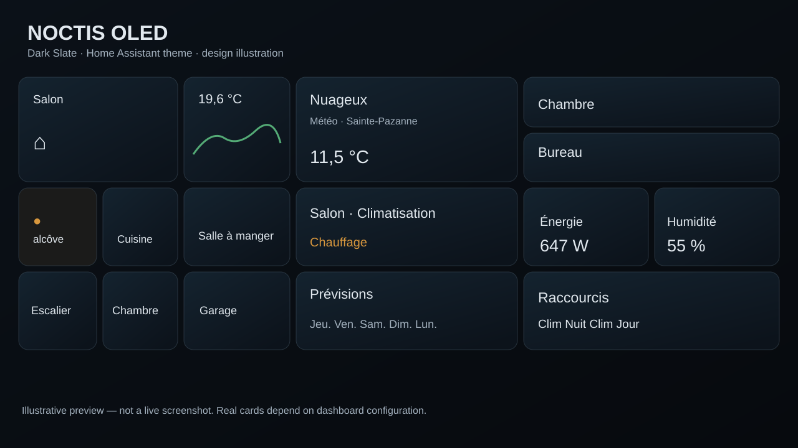

# Noctis OLED 🌙

**A modern, low-glare Home Assistant theme for always-on OLED dashboards.**

Noctis OLED combines near-black page backgrounds with subdued slate-blue card gradients, subtle borders, muted amber active lights, and compact spacing. It is inspired by a dense tablet dashboard with lights, weather, climate and energy cards.



> **Design concept, not an in-app screenshot.** The theme changes styling, not the number or arrangement of your cards. Custom cards can override theme variables.

## Features

- OLED-conscious near-black page backgrounds and low-glare card gradients.
- Fine outlines, soft rounded corners, and restrained shadows.
- Muted amber for active lights and heating, soft blue for cooling, green for status.
- Compact native dashboard spacing where supported.
- Single YAML theme, **no card-mod dependency**.
- Compatible with Home Assistant dashboards on tablets, desktops and mobile.

## Install through HACS / Marketplace

<!-- ha-marketplace:exclude-start -->

### Home Assistant 2026.11 and newer — Marketplace
1. Go to **Settings → Marketplace** (you may be asked to connect GitHub).
2. Choose **Add from link** and paste:
   `https://github.com/Moosketair/home-assistant-noctis-oled-theme`
3. Add and install **Noctis OLED** as a **Theme**.

### Home Assistant 2026.10 and older — HACS
1. Open **HACS → ⋮ → Custom repositories**.
2. Add the URL above and select **Theme**.
3. Download **Noctis OLED**.

<!-- ha-marketplace:exclude-end -->

Check that `configuration.yaml` includes:

```yaml
frontend:
  themes: !include_dir_merge_named themes
```

If a `frontend:` key already exists, merge the `themes:` line into it; don't add a second `frontend:` block.

Reload themes from **Developer Tools → Actions → `frontend.reload_themes`** (or restart Home Assistant). In your **profile**, select theme **Noctis OLED**. The theme only provides dark mode.

## Manual installation

Copy `themes/noctis_oled.yaml` into your Home Assistant `config/themes/` folder, configure `frontend.themes` if needed, reload themes, then select Noctis OLED.

## Customization

Modify theme variables in `themes/noctis_oled.yaml`, then reload the themes.

| Variable | Value | Meaning |
| --- | --- | --- |
| `primary-background-color` | `#090D12` | Main page background |
| `card-background-color` | `#111B25` | Solid fallback card color |
| `ha-card-background` | Slate gradient | Gentle depth on supported cards |
| `ha-card-border-radius` | `15px` | Rounded corners |
| `state-light-active-color` | `#E2A347` | Active lighting |
| `grid-card-gap` | `6px` | Compact native grids (where honored) |
| `ha-view-sections-column-gap` | `6px` | Compact Sections spacing (where honored) |

**Custom cards:** button-card, Mushroom, mini-graph-card, gauge cards, and custom dashboards can use their own styles and ignore theme colors or spacing. A theme alone cannot guarantee the exact screenshot layout. Optional **card-mod** or per-card styling can be used for a closer result; they are not required to install the theme.

## OLED care

Dark colors reduce average luminance, but **cannot prevent OLED burn-in**. Static dashboards, bright labels and clocks can still cause wear. For a tablet that stays on all day, lower brightness, use automatic screen-off/wake where possible, and periodically rotate or hide static elements.

## Project

- Theme: [themes/noctis_oled.yaml](themes/noctis_oled.yaml)
- Changelog: [CHANGELOG.md](CHANGELOG.md)
- License: [MIT](LICENSE)
- Preview: illustration only; actual Home Assistant appearance depends on cards and version.

Created for Moosketair's Home Assistant dashboard.